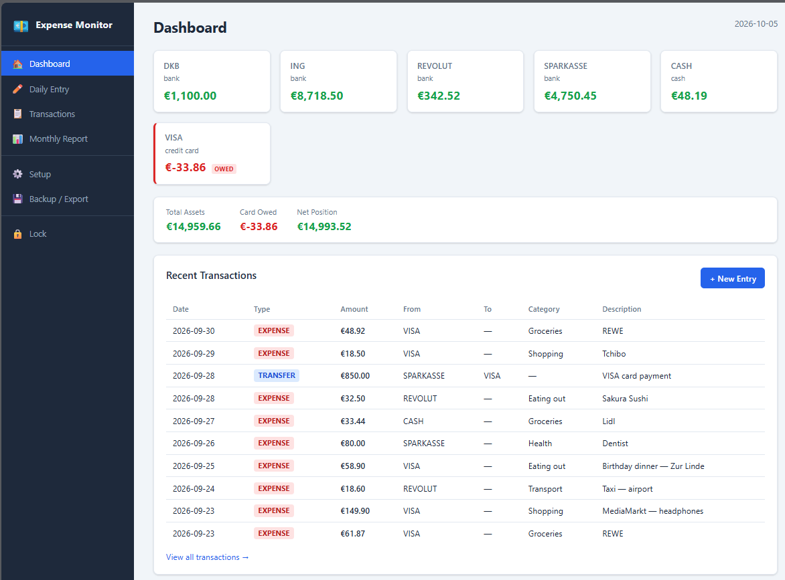
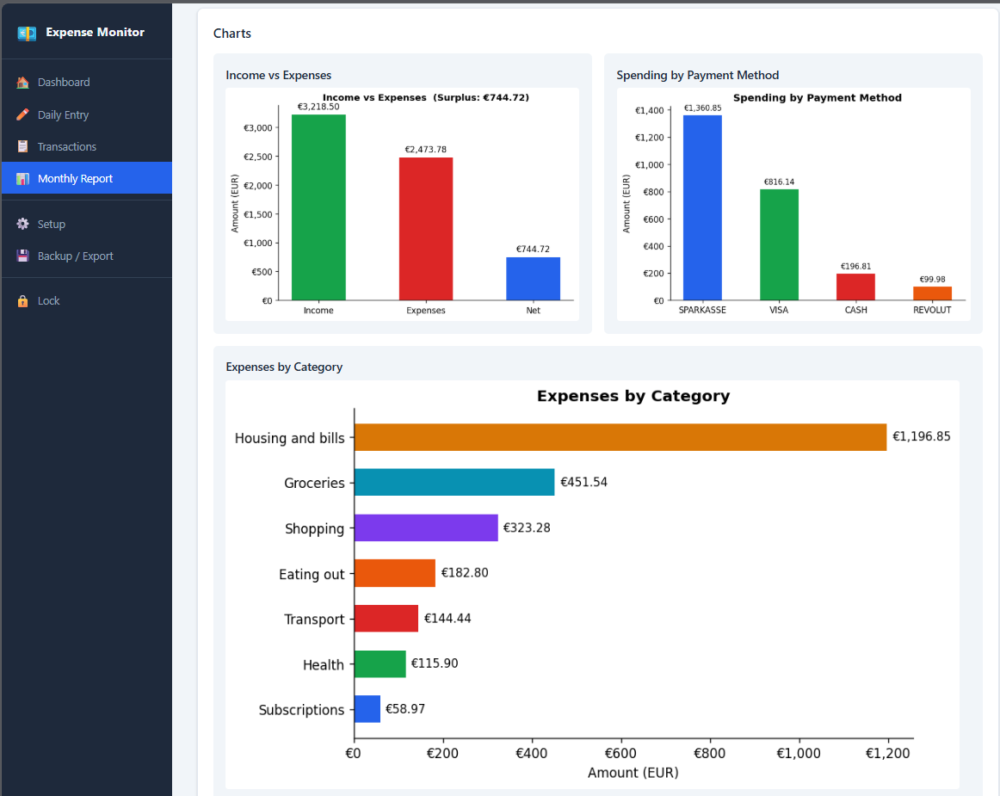
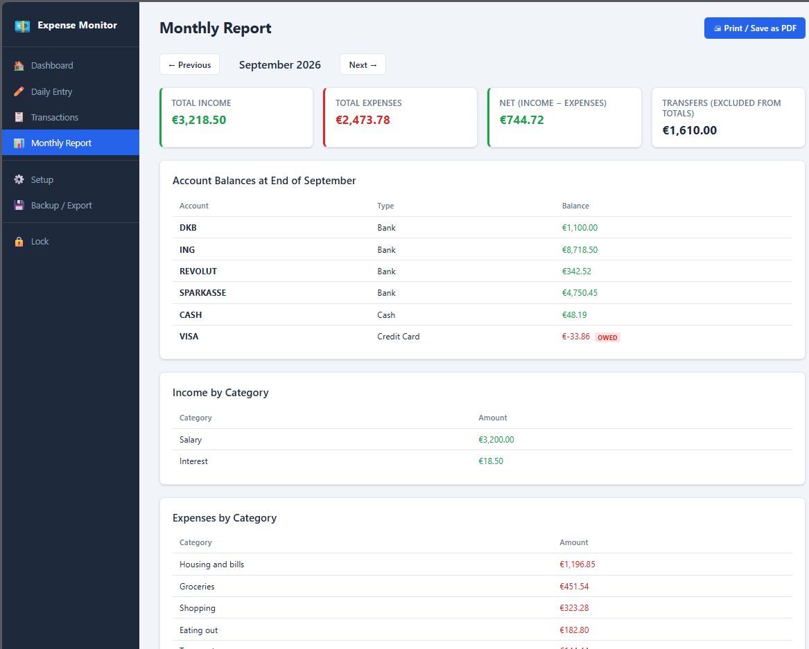

# Expense Monitor

A private, offline personal-expense tracking app for German household finances.
Built with Python, FastAPI, and SQLite. All data stays on your PC.

---

## Preview







The monthly report can be saved as a PDF directly from the browser using **Print → Save as PDF**. Charts, totals, and transaction tables are all print-optimised and paginate cleanly. The PDF below was exported from the demo database for September 2026.

[Monthly Report — September 2026 (PDF)](<docs/demo/Monthly Report — September 2026 — Expense Monitor.pdf>)

---

## Cross-Platform Setup

Two deployment options are provided for Windows, Linux (including Ubuntu 26.04
LTS), and macOS. Initial installation requires internet access.

| Option | Best for | Requirements |
|---|---|---|
| **Docker Compose (recommended for deployment)** | A consistent Python runtime, isolated dependencies, and persistent storage independent of the host OS | Docker Engine with Compose v2 on Linux; Docker Desktop using Linux containers on Windows/macOS |
| **Python venv** | Lightweight local use and development without a container service | Python 3.10+ with `venv` support |

Docker uses Python 3.12 inside a Debian-based Linux image, even on Ubuntu 26.04;
it does not depend on Ubuntu's system Python. A venv isolates Python packages,
but still uses the host's Python version. Neither option encrypts your database.

### Option A: Docker Compose

Install Docker using the [official instructions](https://docs.docker.com/get-started/get-docker/).
On Ubuntu, follow the [Docker Engine Ubuntu installation guide](https://docs.docker.com/engine/install/ubuntu/)
and install the Compose plugin. Then, from this project folder:

```sh
docker compose up --build -d --wait
```

Open **http://127.0.0.1:8000** and choose your PIN. No host Python installation is
needed. The container runs as a non-root user, with a single application worker
because PIN sessions and login lockouts are stored in memory. The server listens
on `0.0.0.0` inside the container, but Compose publishes it only on the host's
`127.0.0.1`, not on your network. Keep that port mapping unchanged for private use.

```sh
docker compose logs -f          # View logs; Ctrl+C exits log viewing
docker compose stop            # Stop the app
docker compose up -d --wait     # Start it again
docker compose down            # Remove the container, keep the database volume
docker compose up --build -d --wait  # Rebuild after application updates
```

The named volume `expense-data` stores `/app/data/expense_monitor.db` independently
of the container. Docker usually prefixes the volume name with the project name.
It is **not** the host's `data/` folder. An existing native database is not imported
automatically. Never use `docker compose down -v` unless you intend to delete
all container-stored transactions and the PIN. Keep external backups as well.

To move an existing native database or restore a backup, first stop any native
instance. Create the Compose container with `docker compose create` if needed,
then run these commands from the project folder (replace the source path for a
different backup):

```sh
docker compose stop
docker compose cp ./data/expense_monitor.db expense-monitor:/app/data/expense_monitor.db
docker compose run --rm --no-deps --user root expense-monitor chown expense:expense /app/data/expense_monitor.db
docker compose up -d --wait
```

These commands replace the container database, including its PIN. Back up any
existing container data first. Use the app's **Backup / Export** page to download
a database backup on any OS. Restoring should use a backup downloaded by the app
or a database copied while its source instance was stopped.

### Option B: Native Python venv

On **Ubuntu 26.04 LTS** (also applicable to other current Ubuntu versions), install
Python and venv support:

```sh
sudo apt update
sudo apt install python3 python3-venv python3-pip
sh setup.sh
sh run.sh
```

On **macOS**, install Python 3.10+ from https://python.org or your package manager,
then run `sh setup.sh` and `sh run.sh`.

On **Windows**, install Python 3.10+ from https://python.org, open a terminal in
this project folder, and run `setup.bat`, then `run.bat`. In PowerShell, use
`.\setup.bat` and `.\run.bat`.

Setup installs dependencies into `venv/`; activation is not required by the launch
scripts. On Linux/macOS, select a specific Python if desired with
`PYTHON=python3.12 sh setup.sh`. Do not reuse or copy a venv between operating
systems or Python versions; recreate it with setup instead.

| Mode | Windows | Linux / macOS | Database |
|---|---|---|---|
| Personal | `run.bat` | `sh run.sh` | `data/expense_monitor.db` |
| Demo | `run_demo.bat` | `sh run_demo.sh` (or `sh run.sh --demo`) | `data/demo.db` |

Demo launchers create the sample September 2026 database on first run without
changing your personal database. Native runs also open at
**http://127.0.0.1:8000**, bound only to localhost. Stop with `Ctrl+C`.

Only run one deployment at a time; the native app and Compose both use port 8000.
The Docker image and native Ubuntu installation must still be validated on the
target host; Windows-based checks alone do not certify an Ubuntu release.

---

## PIN Protection

The app is protected by a PIN. On your very first visit you will be prompted to
choose one (minimum 4 characters — longer and alphanumeric is safer). After that,
every new browser session requires the PIN to unlock.

### PIN behaviour
- **Session length** — 8 hours. After that, or after restarting the app, you must
  enter the PIN again.
- **Lock manually** — click **Lock** at the bottom of the sidebar at any time.
- **Wrong attempts** — 3 consecutive wrong attempts trigger a 30-second cooldown.
- **Change PIN** — go to **Setup → Change PIN**. You need to supply the current PIN
  to set a new one.

### How the PIN is stored
The PIN itself is never saved. What is stored is a one-way cryptographic hash
produced by **PBKDF2-HMAC-SHA256** (100,000 iterations, random salt). The hash
lives in the `settings` table of `data/expense_monitor.db` under the key
`pin_hash`. It is computationally infeasible to reverse a hash back into the PIN.

### Security limits — read this
| Threat | Protection level |
|---|---|
| Someone on your network reaching the app | **Full** — the server only accepts `127.0.0.1` |
| Someone at your PC guessing the PIN in the browser | **Full** — lockout after 3 wrong attempts |
| Someone who copies `expense_monitor.db` and attacks the hash offline | **Partial** — PBKDF2 makes each guess slow (~100 ms), but a short all-numeric PIN (e.g. `1234`) has only 10,000 combinations. Use a longer PIN with mixed characters. |
| Someone who opens `expense_monitor.db` directly with a SQLite viewer | **None** — the PIN protects the web interface only; the database file is **not encrypted** |

**Recommendation:** if the PC is shared or contains sensitive balances, enable
**Windows BitLocker**, **Linux LUKS**, or **macOS FileVault** on the drive that
holds this folder. That protects the database file itself, which is outside the
scope of this app.

---

## First-Time Setup in the App

1. Enter your PIN on the first-visit screen to create it.
2. Go to **Setup** in the sidebar.
3. Enter opening balances and opening dates for each account (BANK-1 through BANK-4, CARD, CASH).
4. Rename account labels to your liking (e.g. "SPARKASSE", "ING").
5. Add or remove expense/income categories if needed.

---

## Entering Transactions

### Single Entry
1. Go to **Daily Entry → Single Transaction**.
2. Select date, type, amount, account(s), category, and description.
3. Click **Save Transaction**.

### Batch Entry from Phone Note
1. During the day, jot transactions on your phone in this format (one per line):
   ```
   DATE | TYPE | AMOUNT | FROM_ACCOUNT | TO_ACCOUNT | CATEGORY | DESCRIPTION
   ```
   Use `-` for fields that don't apply. Example:
   ```
   2026-10-04 | EXPENSE  | 18.70  | CARD   | -      | Eating out | Lunch
   2026-10-04 | INCOME   | 3200   | -      | BANK-1 | Salary     | October salary
   2026-10-04 | TRANSFER | 50.00  | BANK-1 | CASH   | -          | ATM withdrawal
   2026-10-04 | TRANSFER | 200.00 | BANK-1 | CARD   | -          | Card payment
   ```
2. In the evening, go to **Daily Entry → Batch Paste**.
3. Paste your note and click **Preview Entries**.
4. Review the parsed table. Uncheck any row you want to exclude.
   - Invalid rows are shown in red and cannot be saved.
   - Likely duplicates (same date/type/amount/account) are flagged in yellow.
5. Click **Confirm & Save**.

### Transaction Types

| Type     | FROM_ACCOUNT  | TO_ACCOUNT | Counts as           |
|----------|---------------|------------|---------------------|
| EXPENSE  | Paying account| `–`        | Expense             |
| INCOME   | `–`           | Receiving  | Income              |
| TRANSFER | Source        | Destination| Neither             |

**Credit card notes:**
- A card purchase is an **EXPENSE** with `FROM_ACCOUNT = CARD`. Counted once as an expense.
- Paying the credit card from your bank is a **TRANSFER** (`BANK-1 → CARD`). Not a second expense.
- The card balance shown is the **amount owed** (liability), displayed in red.

---

## Monthly Report

1. Go to **Monthly Report**.
2. Use the Previous/Next buttons to navigate months.
3. The report shows:
   - Income/expense totals and net
   - Account balances at end of month
   - Income and expense breakdowns by category
   - Charts: income vs expenses, spending by payment method, expenses by category, daily spending
   - Income & expense flow (Sankey): income sources fan in on the left, expense categories fan out on the right — the visual width difference reflects savings or deficit
   - Full transaction table, with transfers listed separately
4. To **save as PDF**: click the **Print / Save as PDF** button (or press `Ctrl+P`), then choose "Save as PDF" in the print dialog.

---

## Database Location and Backup

For native installations, the SQLite database is stored at:
```
<app folder>/data/expense_monitor.db
```

Docker installations store it in the named volume instead. Use the Docker backup
and restore instructions above; deleting the container does not delete the volume.

### Backing Up
- Go to **Backup / Export → Database Backup** and click **Download expense_monitor.db**.
- Or copy `data/expense_monitor.db` to an external drive or cloud storage manually.

### Restoring from Backup
1. Stop the native app (`Ctrl+C` in the terminal).
2. Copy your backup file to `data/expense_monitor.db` (replace existing file).
3. Start the app again.

> **Note:** your PIN hash is stored inside the database, so it is preserved in
> backups automatically. Restoring a backup restores both your transactions and
> your PIN.

### Exporting to CSV
- Go to **Backup / Export → Export Transactions to CSV**.
- Optionally filter by date range, then click **Download CSV**.
- The CSV can be opened in Excel or LibreOffice Calc.

---

## Running Tests

Windows:
```powershell
.\venv\Scripts\python -m pytest tests -v
```

Linux / macOS:
```sh
venv/bin/python -m pytest tests -v
```

Docker (uses a temporary container without your personal database volume):
```sh
docker build --target test -t expense-monitor-tests .
docker run --rm expense-monitor-tests
```

Tests cover:
- Accounting rules (balance calculations, all transaction types)
- Parser (valid/invalid log entries, German decimal commas, duplicate detection)
- Monthly report calculations (totals, category breakdowns, transfer exclusion)

---

## Offline Operation

After running setup or building the Docker image once (requires internet), the app runs **fully offline** with one exception:
- All assets (Python libraries, CSS, JS) are installed locally.
- Charts are generated server-side using matplotlib.
- **Exception — Sankey chart:** the Income & Expense Flow chart on the Monthly Report page loads [Plotly.js](https://plotly.com/javascript/) from a CDN. It requires an internet connection to display; all other charts and features work offline.

---

## Account Types Reference

| Label  | Type        | Balance Meaning             |
|--------|-------------|-----------------------------|
| BANK-1 | Bank        | Money available (asset)     |
| CASH   | Cash        | Cash on hand (asset)        |
| CARD   | Credit Card | Amount owed (liability, red)|

---

## Troubleshooting

**Native app won't start:** Make sure Python 3.10+ is installed and the appropriate setup script was run.

**"Module not found" error:** Run through the launch script, which selects the local venv. Re-run setup if dependencies are missing.

**Ubuntu: `ensurepip` or `venv` unavailable:** Install `python3-venv` with apt, then run `sh setup.sh` again. For a non-default Python, install its matching venv package.

**Shell script reports `\r` or a bad interpreter:** Re-check out the shell scripts with LF line endings. The repository's `.gitattributes` enforces LF for `*.sh`.

**Docker won't start:** Verify `docker compose version` works and the Docker service/Desktop is running. On Linux, follow Docker's documented permission setup or run Docker commands with appropriate privileges. Inspect `docker compose logs` for startup errors.

**Port 8000 is already in use:** Stop the other app instance. For Docker only, change the mapping to `127.0.0.1:8001:8000` and open http://127.0.0.1:8001.

**Database locked:** Only one instance of the app should run at a time. Close other instances and retry.

**Charts not showing:** matplotlib is required. Re-run setup or rebuild the Docker image if dependencies are missing. No graphical desktop is needed on Linux.

**Sankey chart not showing:** The Income & Expense Flow chart requires an internet connection to load Plotly.js from a CDN. All other charts are unaffected.

**Forgot PIN:** There is no recovery prompt by design. To reset the PIN:
1. Stop the app.
2. Run: `venv\Scripts\python -c "import database as db; db.init_db(); conn=__import__('sqlite3').connect('data/expense_monitor.db'); conn.execute(\"DELETE FROM settings WHERE key='pin_hash'\"); conn.commit(); conn.close(); print('PIN cleared')"`
3. Restart the app and set a new PIN on the first-visit screen.
   Your transactions and account data are untouched.

---

## Acknowledgements

This app was built with the assistance of [Claude](https://claude.ai) by Anthropic.

The full specification used to build it is in [`prompt.md`](prompt.md).
