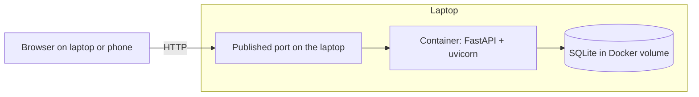
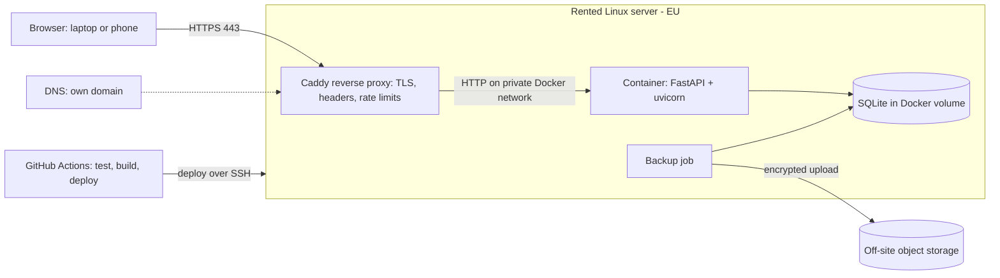
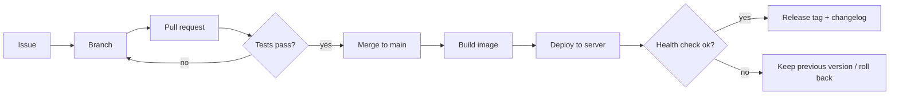

# Architecture

Status: Draft · Last updated: 2026-11-08

## 1. Current architecture (local)

- One container image, built from the `Dockerfile` (multi-stage: `app`, `test`,
  `production`). It runs as a non-root user with a single worker.
- Data lives in a named Docker volume. Pages are rendered on the server (Jinja2) and
  charts are generated with matplotlib; the Sankey diagram loads Plotly from a CDN.
- Access is limited to the laptop and the home network; there is no encryption in
  transit.

## 2. Target architecture (cloud)

### Components

| Component | Responsibility | Decision |
|---|---|---|
| VPS | Runs everything; owner administers it | [ADR-0001](adr/0001-host-on-a-vps.md) |
| Caddy | TLS termination with automatic certificates, HTTP to HTTPS redirect, security headers, first-layer request limits | [ADR-0002](adr/0002-caddy-reverse-proxy-for-https.md) |
| Application container | Business logic, authentication, reports | existing code |
| SQLite database | Persistent data in a Docker volume | [ADR-0004](adr/0004-keep-sqlite.md) |
| Backup job | Consistent SQLite backup, encrypted, uploaded off-site | requirement R-07 |
| CI/CD | Tests gate merges; successful merges deploy | requirements R-09 to R-11 |

### Network exposure

Only the proxy listens on the public interface (ports 80 and 443). The application
container is reachable only from the proxy over the internal Docker network. SSH is
the only other entry point and is key-only.

### Trust boundaries

1. **Internet to proxy.** Everything untrusted. TLS, rate limiting, security headers.
2. **Proxy to application.** Trusted network, but the application still authenticates
   every request.
3. **Application to database.** Local file access inside the container.
4. **Server to off-site storage.** Backups are encrypted before leaving the server;
   the storage provider never sees plaintext.
5. **GitHub to server.** The deploy key has minimal permissions and is stored as a
   repository secret, never in the code.

## 3. Data and authorization

- Single SQLite database file. Contains users, and per-user transactions, accounts,
  categories, and settings, plus credential hashes.
- **Ownership.** Every data row has a `user_id`. Every data-access function requires
  the current user's ID and filters on it; the user comes from the authenticated
  session, never from the request ([ADR-0006](adr/0006-multi-user-with-isolated-data.md)).
- **Refusals look like "not found".** Asking for another user's record returns the
  same response as asking for one that does not exist.
- **Roles.** Administrator (creates and disables users, may download the
  whole-database backup) and user (own data only). The administrator is also a normal
  user with a private ledger; the role adds management functions, not access to other
  users' ledgers.
- Backups use SQLite's online backup mechanism so they are consistent while the app
  runs.
- Data is not encrypted at rest on the server. Mitigations: restricted server access,
  provider-side disk handling, and encrypted backups. Revisit if the threat model
  changes.

## 4. Verification architecture

How each kind of requirement gets proven ([ADR-0007](adr/0007-requirements-verified-by-tests-and-evidence.md)):

| Layer | Runs | Checks | Examples |
|---|---|---|---|
| Unit and API tests (pytest, FastAPI test client, two test users) | In CI on every change | Business rules, authentication, authorization, data isolation, migration | R-03 to R-06, R-17 to R-21, N-09, N-10 |
| Smoke tests against the live site | After every deploy | HTTPS, redirects, headers, closed ports, login page, version | R-01, R-13, N-01, N-02 |
| Recorded manual checks and drills | At milestones and periodically | Restore, hardening, rollback, monitoring | R-08, R-11, R-12, R-14 |

A route-enumeration test lists every route the application registers and fails if
one has no authentication test or, where it touches user data, no authorization test
(N-09). New endpoints therefore cannot ship untested.

## 5. Deployment and release flow (target)

## 6. Open questions

- Should users ever share data (a shared household view)? Currently out of scope;
  would need its own ADR.
- Which domain registrar and DNS host? (Decide in phase 3.)
- Which object-storage provider for backups, and which tool (for example restic)?
  (Decide in phase 5; will get its own ADR.)
- Whether to persist sessions in the database so they survive restarts. (Decide in
  phase 4.)
- Whether to add TOTP in the first release of the new login or as a follow-up.

## 7. Risks

| Risk | Impact | Mitigation |
|---|---|---|
| A query misses its user filter (one user sees another's data) | Privacy breach between users | Required-parameter data layer, two-user tests on every route (R-18, N-09) |
| Whole-database backup download reachable by a normal user | Every user's data exposed | Administrator-only (R-21) |
| Migration to the multi-user schema loses or corrupts data | Loss of financial history | Backup first, tested on a fixture and on a copy of the real database (R-19) |
| Internet-facing login attacked by bots | Account compromise, lockout | R-03 to R-06, proxy-level limits |
| Server compromised | Data exposure | Hardening (R-14), minimal exposed surface, patching |
| Data loss (disk failure, mistake) | Loss of financial history | Off-site backups with tested restore (R-07, R-08) |
| Provider outage | Downtime | Accepted for a personal service (N-03); restore elsewhere using the runbook |
| Secret committed to the public repo | Credential leak | R-15, review checklist |
